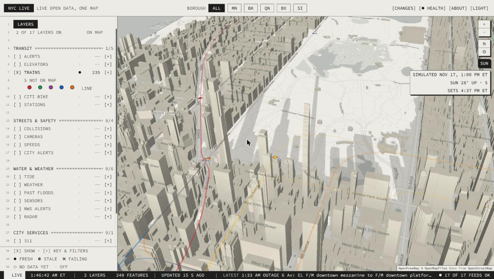
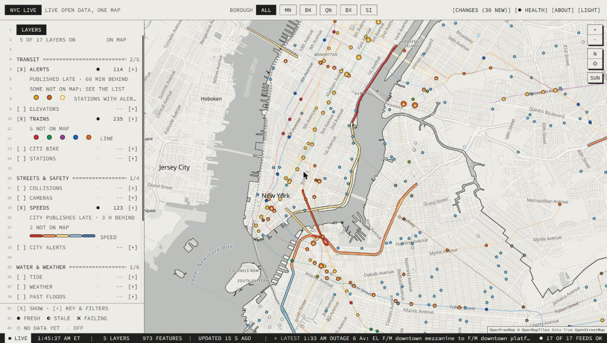
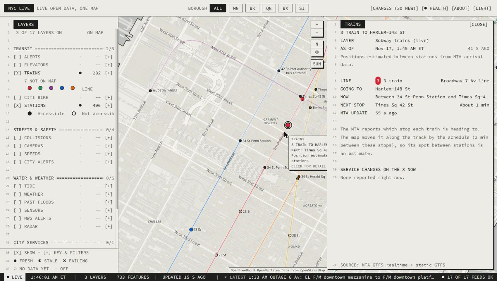
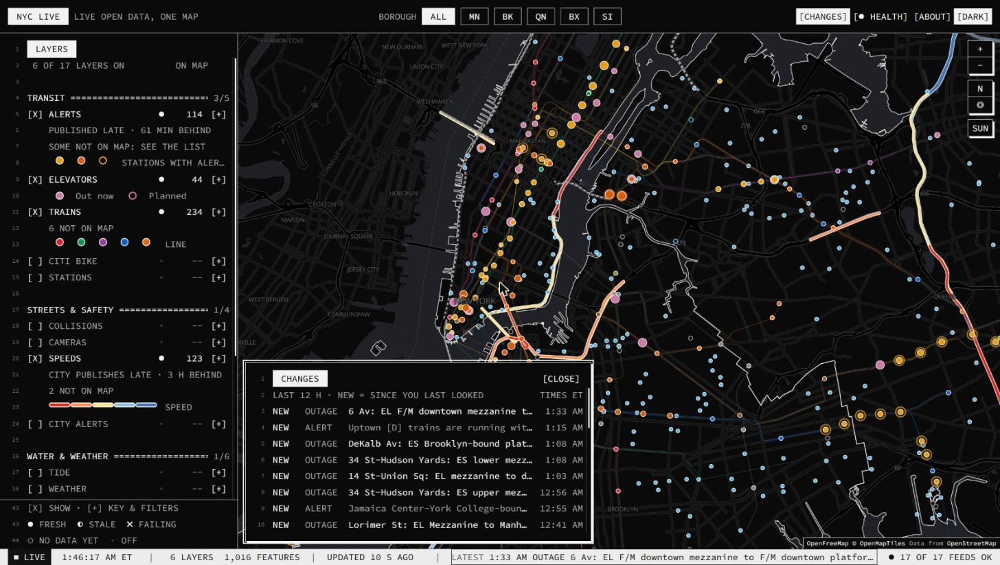
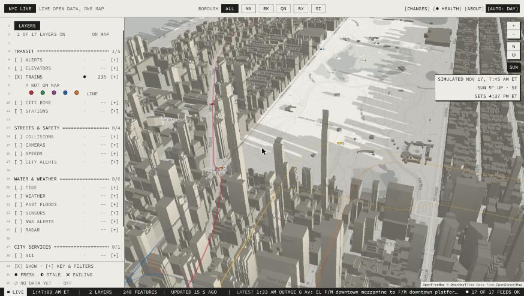
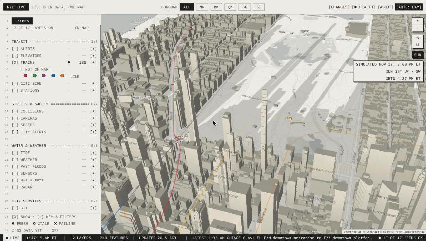
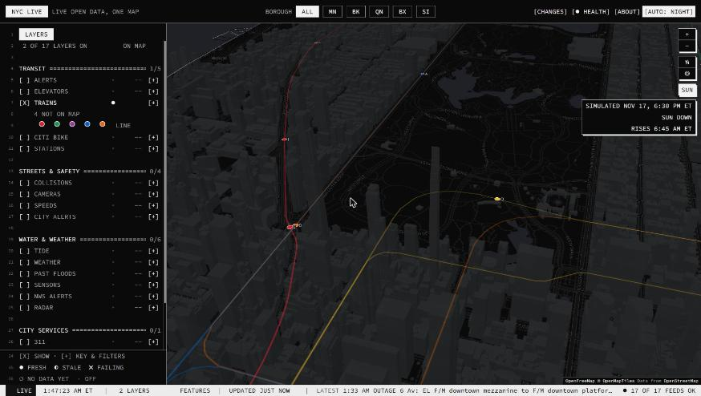
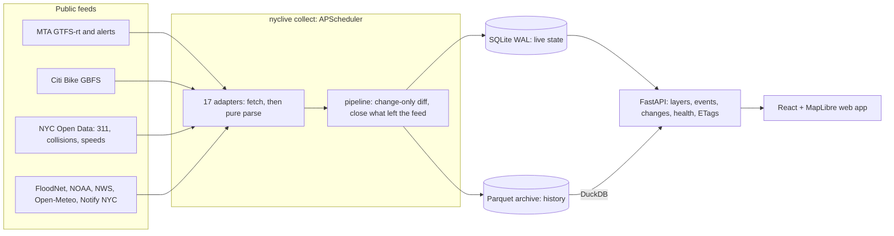

# NYC Live

**A live map of New York City built from 17 public data feeds:** subway trains moving on their
tracks, Citi Bike docks, subway and city alerts, street-flood sensors, road speeds, tides, weather
and more. The 3D city is lit by the real sun, with every building casting its shadow.



> **Status:** the collectors, archive, API and live map all run; they passed a 48-hour unattended
> soak test. Not hosted yet: it runs locally (Quickstart below), and moves to an always-on home
> server next ([ADR-009](docs/DECISIONS.md)). Next up: a time slider to rewind the map
> ([Phase 3](docs/ROADMAP.md)).

---

## What it does

| | |
|---|---|
|  | **17 live layers on one map.** Toggle subway trains (from MTA GTFS-realtime), stations, service alerts, elevator outages, Citi Bike (2,500 stations), road speeds, collisions, 311 complaints, NWS weather alerts, Notify NYC city alerts, FloodNet street-flood sensors, the Battery tide gauge, weather, radar and traffic cameras. Every layer shows how fresh its feed is, and says plainly when the city publishes late. |
|  | **Click anything for plain-English detail.** A train shows where it's going, where it is right now, its next stop and ETA, and the route's current service changes. Trains glide along the real track geometry between MTA updates, with no jumps when late data arrives. |
|  | **A live CHANGES feed:** new alerts, outages and floods as they happen; click one to fly to it. Light, dark and **AUTO** themes; AUTO follows the real sun at the map center and crossfades between day and night. |

**A day over Central Park, with the sun computed for each moment** (theme AUTO):

| 7:45 AM: sun 9° SE | 3:00 PM: sun 15° SW | 6:30 PM: night |
|---|---|---|
|  |  |  |

Tilt the map (Ctrl + scroll, or two fingers on touch) and the buildings rise in 3D. Every view is
a shareable URL.

---

## What this project demonstrates

**Data engineering**
- **17 production collectors** behind one adapter contract: `fetch` is network-only and `parse` is
  pure. Every adapter is tested offline on captured real responses plus edge cases (empty feeds,
  HTML error pages, truncated bodies).
- **Formats handled:** JSON, GeoJSON, Socrata, GBFS, CAP 1.2 XML, RSS, and **GTFS-realtime
  protobuf, decoded with a hand-written standard-library decoder**.
- **A change-only archive:** about 5 GB a day is downloaded, but only changes are kept, about
  5–10 MB a day.
  - Parquet, hive-partitioned, compacted daily, crash-safe (deduped on read).
  - SQLite in WAL mode holds the live state.
  - DuckDB answers "state as of time *t*".
- **A 48-hour unattended soak test:** no gaps, every source ≥ 95% successful, 3.3 MB/day stored,
  0.05% CPU.

**Backend**
- **API:** FastAPI, read-only over the state DB.
- **Caching:** weak ETags with `304`s, a per-layer response cache keyed on each source's last
  run, and gzip.
- **Derived data:** borough resolution (point-in-polygon), event windows anchored to each feed's
  real "as of" time, and change detection for the live feed.

**Frontend and maps**
- **Stack:** React 19, TypeScript, MapLibre GL, Zustand, Vite.
- **Custom design system:** a monospace "printed transcript" style with stepped, purposeful
  motion and reduced-motion fallbacks.
- **Animated trains:** positions are interpolated along GTFS shape geometry. When MTA data arrives
  late, a "catch-up" run carries each train from where it's drawn along the track instead of
  jumping. That removed a synchronized lurch: measured on the live feed, a median of 188 m and up
  to 4 km per update.
- **3D buildings** from OpenStreetMap heights, fading in with the tilt; the style light follows
  the sun.
- **Gestures for trackpad, mouse and touch**, including telling a real Ctrl key from a pinch.
- **Themes:** light, dark and AUTO, with `@property`-registered color tokens that animate, and a
  WebGL crossfade between basemaps.

**Geometry and math**
- **Sun position** from NOAA's solar equations, cross-checked in tests against an independent
  formula (within 0.35° all year) and NYC's solstice and equinox noon heights.
- **Building shadows** computed in the browser:
  - each footprint is swept away from the sun by height × cot(altitude), as a Minkowski sweep;
  - all sweeps are drawn on one canvas, so overlapping shadows union instead of darkening;
  - ordered so a roof is shaded only by taller buildings;
  - 30–120 ms per redraw for 8k–16k building parts (measured in Midtown and at Central Park).

**Testing and quality**
- **720 automated tests:** 409 pytest and 311 vitest, all offline. Live-network tests are opt-in.
- **Schema checks:** conformance tests force every live source to have real and edge-case
  fixtures, and catalog validation keeps the map config and the API builders in lockstep.
- ruff, ESLint and TypeScript strict mode.

**Performance and operations**
- **Measured, then fixed:**
  - MapLibre ran a single worker by default, so zooming a tilted map lagged; it now runs 2–4;
  - setData backpressure for 30 fps animation;
  - rasterized shadows instead of polygon unions.
- **Go-live tooling:** a feed health probe, a soak report, a go-live checker, and a sun
  "time-lapse" simulator in the console (`nlSun.timelapse()`).
- **16 Architecture Decision Records** explaining why X over Y ([docs/DECISIONS.md](docs/DECISIONS.md)).

About 21,000 lines of application code (8.6k Python and 12.1k TypeScript) and 10,000 lines of tests.

---

## Architecture



Everything is **keyless**: no API keys or accounts for any feed ([ADR-007](docs/DECISIONS.md)).

---

## Quickstart

Prerequisites: [uv](https://docs.astral.sh/uv/) (it installs Python 3.12 for you), Node 20+, and git.

```bash
git clone https://github.com/alexxu2027/nyc-data && cd nyc-data
uv sync --extra api                     # Python env + deps
cd web && npm ci && npm run build && cd ..
uv run nyclive collect --keep-awake     # start collecting (leave running); data goes to ./data
uv run nyclive serve                    # in a second terminal: open http://localhost:8000
```

Other commands:

```bash
uv run nyclive sources     # every registered feed
uv run nyclive probe       # is each feed reachable right now?
uv run nyclive status      # health of each collected source
uv run pytest              # offline Python tests (add -m live for network tests)
cd web && npm test         # web tests
```

In the browser console, `nlSun.timelapse()` runs a day of sun and shadows in 40 seconds (turn
**SUN** on and tilt the map first).

---

## Documentation

| Doc | What's in it |
|---|---|
| [docs/ARCHITECTURE.md](docs/ARCHITECTURE.md) | Components, data flow, storage, API, frontend, measured soak numbers |
| [docs/DECISIONS.md](docs/DECISIONS.md) | Architecture decision records: why X over Y |
| [docs/DATA_SOURCES.md](docs/DATA_SOURCES.md) | Every feed: endpoint, cadence, quirks, verification status |
| [docs/DATA_MODEL.md](docs/DATA_MODEL.md) | Entities, observations and events; the adapter contract |
| [docs/ROADMAP.md](docs/ROADMAP.md) | Phases, tasks and acceptance criteria |
| [docs/PRD.md](docs/PRD.md) | Product requirements: goals, users, success criteria |
| [docs/research/](docs/research/) | Design notes: replay, 3D and shadows, late-data alternatives, CV, "Ask the map" |
| [config/sources.yaml](config/sources.yaml) / [config/layers.yaml](config/layers.yaml) | The feed registry and the map catalog (sources of truth) |

**Roadmap:**
- ✅ Collectors and archive
- ✅ Live map
- ✅ Liveness: trains, radar, flood depth, changes
- ✅ 3D and sun
- ⏭ Replay (time slider)
- Then: traffic cameras as sensors (object counts with YOLO on a GPU), "Ask the map", and a
  public deployment.

---

## Data and ethics

All sources are public and keyless. NYC Live counts and aggregates; it does **not** do face or
license-plate recognition or track individuals, and camera frames are kept only briefly. Data
belongs to its publishers (MTA, NYC DOT, NYC Open Data, NYC Emergency Management, Lyft/Citi Bike,
NOAA, NWS, FloodNet, Open-Meteo, OpenStreetMap/OpenMapTiles), and the app credits each one.
Shadows are an estimate from OpenStreetMap building heights.

## License

Code: [MIT](LICENSE). Data and fixture samples belong to their publishers.
